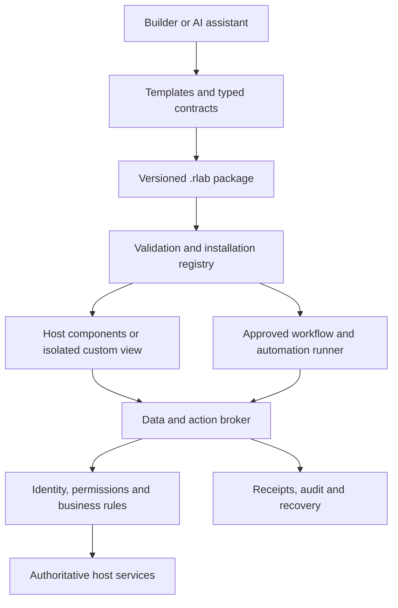

# Build once against a clear host contract

**Draft developer experience and host implementation guide | 0.3**

## 1. What a builder should experience

The normal starting point should be **Create a tool** inside a compatible host, or the same workflow through the builder's chosen AI assistant. Use the customer's current login, approved connections and selected location/context. Do not ask ordinary builders to create an OAuth application, copy API keys, design a permission dialog, buy hosting or write `postMessage` handlers.

| Builder step | Experience | Host/tooling provides |
|---|---|---|
| Describe | “Show fleet pressure by class, with a button to flag a concern.” | Capability-aware prompts and explanations in business language |
| Choose | Start from Fleet Pressure Board, add Flag for review | Approved component/query/action catalogue and constraints |
| Preview | Realistic synthetic scenarios in the host's theme | Sample data, loading/denied/empty/stale cases and responsive preview |
| Inspect | “Reads fleet summaries. Can create review tasks. Cannot change rates.” | Permission derivation, known limitations and a source view |
| Test | “Does this work with missing data and restricted locations?” | Validation, negative fixtures and actionable errors |
| Install | Administrator selects scope; user opens it in their workspace | Identity, storage, deployment, version pinning and audit |
| Improve | Edit one component or rule, compare, test and update | Change diff, permission diff, preview and rollback |

For an authorised read-only template with no external processing, the host may allow self-install within an administrator-preapproved sandbox or scope. That is explicit tenant policy, not a bypass. Elevated data access, new destinations, side effects and automation activation require their appropriate approval. Keep these choices visible and proportionate.

## 2. Example: from a view to a useful workflow

**Level 1:** Fleet Pressure Board shows rentable units, committed units, utilization denominator and coverage. It flags missing or stale data. The builder defines what matters; the host supplies authorised location/class data and components.

**Level 2:** Add “Create review task”. The host supplies a validated form, checks the selected location and records the task. The builder writes neither a task database nor audit code. A later rate-proposal action would use the host's actual proposal contract, if available.

**Level 3:** Add “Start review”. The host runs a saved sequence that gathers the current evidence, creates a task, pauses for the appropriate reviewer and records the next step. The browser may close while the run waits.

**Level 4:** The operator activates the same workflow at an approved local time, initially in shadow mode. The automation can create tasks within a budget, while any action requiring human approval still waits for a person. Production pricing is a separate, specifically approved use case.

This progression preserves a useful first tool. It does not require every builder to reach Level 4 or adopt RME.

## 3. Compose format: readable and AI-friendly

A small view might look like this. The exact fixture format is under `schemas/` and `examples/`; contract IDs below are synthetic.

```json
{
  "uiVersion": "0.3.0",
  "title": "Fleet review",
  "components": [
    {"type": "Text", "text": "Review authorised fleet data before taking action."},
    {"type": "DataTable", "query": "fleet", "columns": ["location", "class", "rentableUnits", "committedUnits"]},
    {"type": "ActionButton", "label": "Create review task", "action": "create-task"}
  ]
}
```

The `fleet` query and `create-task` action are manifest bindings to reviewed contracts, not URLs. The host supplies required action fields from a trusted form using the action's input schema and allowed context defaults. It validates all inputs server-side. The renderer is responsible for field labels, errors, empty data, keyboard access and focus handling; the builder supplies understandable wording and domain choices.

The preview grammar lists display columns rather than a formula language. Do not infer that arbitrary field names, expressions, HTML or links are accepted. The host contract allowlists fields and their units. If a builder requests an unsupported field, the tool explains the limitation and the required adapter work.

## 4. Coded SDK experience

Illustrative SDK shape, not runnable package names:

```typescript
defineExtension({
  render({components, context, queries, actions}) {
    return components.table({
      title: "Fleet pressure",
      source: queries.fleet({locations: context.locations}),
      onReview: selected => actions.request("create-task", {selection: selected})
    });
  }
});
```

The bridge handles transport, cancellation, context versions and safe errors. The action request opens host-owned controls when necessary. The developer cannot obtain unrestricted parent DOM or general credentials through this interface. Type generation uses pinned service/component schemas, and the SDK's server checks remain authoritative even if client typings are changed.

## 5. Development tools to build

One CLI and one MCP adapter should expose the same core operations. Proposed CLI verbs: `new`, `discover`, `dev`, `check`, `test`, `pack`, `preview`, `submit`, `install`, `diff` and `rollback`. These are a design target, not commands installed by this kit.

One local emulator should provide synthetic host context, selected component contract versions, deterministic service fixtures and fault injection. Examples: missing class mapping, stale rate shop, full-rental-period availability unknown, action denied, version conflict, approval pending and downstream timeout. A standalone browser preview is useful for appearance but cannot count as a passed tenant/security test.

The SDK should generate version-pinned types, explanatory permission requests and an SBOM; it should make source, manifests and tests readable. Avoid a proprietary visual format with no export. A builder should be able to inspect a package, keep it under Git and use any approved AI/development tool without giving that tool production credentials.

Suggested agent interface, all draft:

| Tool | Behaviour |
|---|---|
| `catalog.get` | Return authorised schemas/components/actions and examples |
| `extension.validate` | Return field-specific errors, suggested fixes and unsupported host features |
| `preview.create` | Create an isolated synthetic preview |
| `permission.explain` | Explain the exact requested data/effects and why each is needed |
| `change.diff` | Compare source, scopes, actions, destinations and workflow changes |
| `submission.create` | Submit a specific digest for review, not activate it |
| `install.request` | Ask the host's permission flow to install that digest |

An AI-generated plan or tool call cannot self-approve a sensitive installation or effect. Promote only the artifact digest actually reviewed. Treat data and documentation returned to agents as untrusted content that cannot override host instructions or alter approval policy.

## 6. Host implementation architecture



Do not load unknown third-party code into the host merely to make it look native. For Compose, the host renderer consumes data-only documents and its own vetted components. For coded UI, an independent sandbox communicates through a strictly validated bridge. All requests converge on the same server authorisation and operation services.

### Host work packages

| Work package | Concrete deliverable | Acceptance evidence |
|---|---|---|
| Catalogue | Versioned data/action/component/surface schemas | Two different extensions use the same contracts |
| Compose renderer | Typed components with bounded inputs, no executable expressions | Injection, excessive-tree, accessibility and context-change tests |
| Extension registry | Identity/digest/licence review, grants, install/update/revoke | Permission diff, current-policy rollback and reliable suspension |
| Data broker | Native-host adapters, consistent envelopes and location/field restrictions | Cross-tenant and stale-context negative tests |
| Action broker | Prepare/preview/authorise/commit/status | Tamper/replay/conflict and partial-success tests |
| Workflow runner | Durable graph, run identity and checkpoints | Restart without duplicate effects; approval binding |
| Automation runner | Mandates, triggers, quotas, shadow mode and disable controls | Event dedup, expiry, owner departure and mid-run revocation tests |
| Developer tools | Template/emulator/typed SDK/CLI/MCP | New builder completes and explains a useful extension |
| Operations | Diagnostics, support, retention and incident controls | Tenant-scoped support access and a recovery exercise |

For RME, reuse its identity, integration queues, rule/validation logic and audit systems rather than duplicate them inside RevenueLab. Other hosts implement equivalent adapters to their own authorised systems. The same extension runs across hosts only when the semantic contracts match; a host-specific data mapping must disclose missing fields and different meanings. Classify compatibility by tested capabilities, not vendor logo.

## 7. Install and update experience

Installation summary should answer five questions: Who made this? What will it read? What can it change? Can it run while I am away? Who supports it? Show the selected scope and external processing separately. Present plain examples: “Can create review tasks for Lisbon and Porto. Cannot publish rates.”

Keep the approval outside extension-controlled UI. Host policy can preapprove specific reviewed templates/scopes for low-friction installation. New grants, required services, surfaces exposing new context, external destinations, executable code or automation behaviour trigger review. A no-permission-change visual patch can follow a lighter tenant-approved update policy after validation; it still creates a new immutable version and digest.

Updates must show capability/behaviour diffs as well as source diffs. An extension must not quietly move from a manually started action to unattended execution. Automation mandates bind exact versions and require explicit migration; stopping an old version and enabling the new one must not cause two schedules to run.

## 8. Staged delivery that proves the benefit

**First:** a host-native Level 1 Compose renderer with a Fleet Pressure Board and Rate Data Checker, plus a catalogue and synthetic emulator. Prove a builder can create a useful tool without hosting setup or security boilerplate.

**Next:** Level 2 low-risk tasks/notes and proposal creation with a reusable action broker. Add live operational writes only where the host has implemented and approved that exact contract.

**Then:** durable human-started workflows and the coded component path, driven by concrete use cases the declarative catalogue cannot express.

**Finally:** shadow-mode automation, narrow live mandates and optional advanced private/server compute. A static higher-level design can be reviewed now; deployment proceeds only after its controls pass.

This sequence requires real platform investment from hosts. The adoption advantage comes from amortising that work across many builders and extensions. Do not promise that installing an iframe library or JSON renderer completes the platform.
